
<picture><source media="(prefers-color-scheme: dark)" srcset="https://raw.githubusercontent.com/noxhex/noxhex/main/assets/hero-thiago-dark.svg"></picture>

<a href="https://nithron.com">nithron.com</a> · <a href="https://ai.nithron.com">ai.nithron.com</a> · <a href="https://github.com/Nithron">Nithron on GitHub</a> · <a href="https://github.com/Nithron-Intelligence">Nithron Intelligence on GitHub</a>

I run [Nithron](https://nithron.com), a one-engineer studio. Client engineering is the day job. The software and the research are what it builds for itself.

<picture><source media="(prefers-color-scheme: dark)" srcset="https://raw.githubusercontent.com/noxhex/noxhex/main/assets/h-in-short-dark.svg">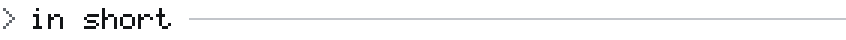</picture>

<picture><source media="(prefers-color-scheme: dark)" srcset="https://raw.githubusercontent.com/noxhex/noxhex/main/assets/plate-whoami-dark.svg">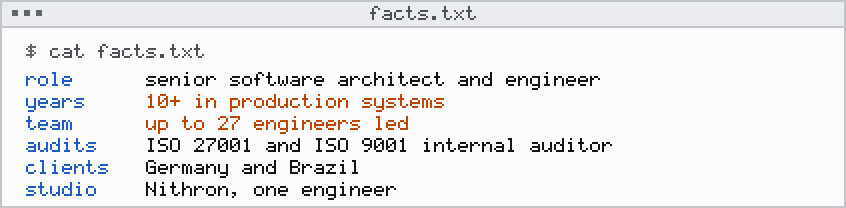</picture>

<picture><source media="(prefers-color-scheme: dark)" srcset="https://raw.githubusercontent.com/noxhex/noxhex/main/assets/h-the-record-dark.svg">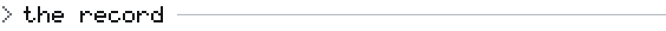</picture>

Client work, with dates. More in the [case studies](https://nithron.com/case-studies/).

| Result | Where | When |
|:--|:--|:--|
| Document search memory from about 1.2 GB to 400 MB, and 20 microservices moved to .NET 6 | Aviation | 2025, independent work alongside Nithron |
| One platform for 270 people on four sites | Manufacturing | 2024 to 2025, independent work alongside Nithron |
| A migration of 300+ tests planned for two years, done in one week | Enterprise software, at OSYON | Before Nithron |

<picture><source media="(prefers-color-scheme: dark)" srcset="https://raw.githubusercontent.com/noxhex/noxhex/main/assets/h-what-nithron-builds-dark.svg">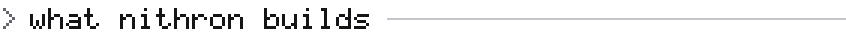</picture>

<a href="https://github.com/Nithron/nOS"><picture><source media="(prefers-color-scheme: dark)" srcset="https://raw.githubusercontent.com/noxhex/noxhex/main/assets/card-nos-dark.svg">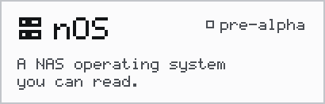</picture></a> <a href="https://github.com/Nithron-Intelligence/nAI"><picture><source media="(prefers-color-scheme: dark)" srcset="https://raw.githubusercontent.com/noxhex/noxhex/main/assets/card-nai-dark.svg">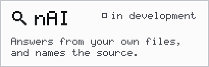</picture></a>

<a href="https://github.com/Nithron/Niro"><picture><source media="(prefers-color-scheme: dark)" srcset="https://raw.githubusercontent.com/noxhex/noxhex/main/assets/card-niro-dark.svg">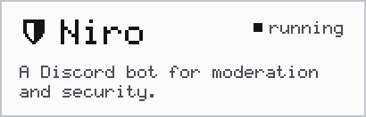</picture></a> <a href="https://ai.nithron.com"><picture><source media="(prefers-color-scheme: dark)" srcset="https://raw.githubusercontent.com/noxhex/noxhex/main/assets/card-lab-dark.svg">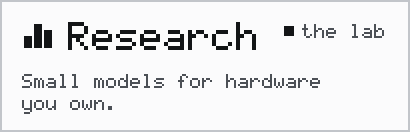</picture></a>

All three products are source-available under the Nithron Community License v1.0. That is not open source: read each LICENSE before you ship anything.

<picture><source media="(prefers-color-scheme: dark)" srcset="https://raw.githubusercontent.com/noxhex/noxhex/main/assets/h-working-languages-dark.svg">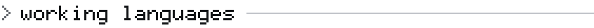</picture>

<picture><source media="(prefers-color-scheme: dark)" srcset="https://raw.githubusercontent.com/noxhex/noxhex/main/assets/chips-languages-dark.svg">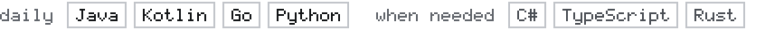</picture>

<picture><source media="(prefers-color-scheme: dark)" srcset="https://raw.githubusercontent.com/noxhex/noxhex/main/assets/h-contact-dark.svg">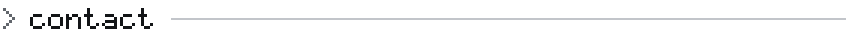</picture>

Not taking new projects right now. Still worth a message: hello@nithron.com. Replies come from one person.
